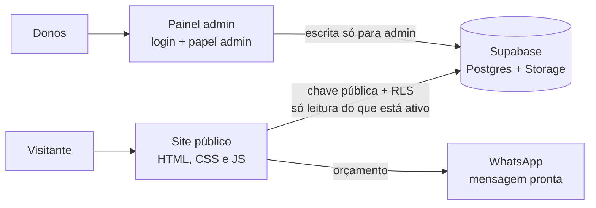

# AcriLife · catálogo online e painel administrativo

Site da **AcriLife**, empresa de produtos em acrílico, LED e comunicação visual em São Paulo, no ar em
**[acrilife.com.br](https://acrilife.com.br)**. O cliente navega pelo catálogo e pede orçamento pelo WhatsApp
com o produto já preenchido; os donos cadastram produtos, fotos e categorias sozinhos, num painel próprio,
sem depender de código.

Desenvolvido por mim, do zero: produto, front-end, banco, segurança e deploy.

## Como funciona



Não há servidor próprio: o site é estático no Netlify e conversa direto com o Supabase. Quem decide o que cada
um pode ler ou gravar é o banco, com Row Level Security, e não a tela.

## Site público (`acrilife publico/`)

- Catálogo com filtro por categoria (com contagem), busca que ignora acentos e procura também por código e descrição.
- Página do produto com galeria (setas, teclado, swipe no celular, tela cheia), breadcrumb, produtos relacionados
  e SEO por produto (título, descrição e Open Graph montados a partir do banco).
- Botão de orçamento que abre o WhatsApp com produto e código na mensagem.
- Cache local de 1 hora e consultas só com as colunas usadas, para carregar rápido.
- LGPD: páginas de privacidade e termos e aviso de cookies com Aceitar, Recusar e Personalizar. Google Analytics
  e Google Ads começam bloqueados (Consent Mode v2) e só rodam depois do aceite.
- Acessível por teclado, respeita "reduzir movimento" do sistema e escapa todo texto vindo do banco (sem XSS).

## Painel admin (`admin/`)

- Login com Supabase Auth; só usuários com papel `admin` entram, e a sessão expirada volta para o login.
- Produtos: criar, editar, duplicar, ocultar do site sem excluir, excluir em massa com confirmação.
- Fotos: arrastar e soltar várias de uma vez, reordenar, escolher a principal. Antes do upload, cada imagem é
  **redimensionada e comprimida no navegador** (canvas), o que economiza armazenamento e banda.
- Categorias com ordem, ícone e status; configurações da empresa (contatos, horários, redes, banner) sem editar JSON.
- Recuperação e troca de senha pelo Supabase Auth.

## Segurança

- **RLS no Postgres** ([`supabase/seguranca-rls.sql`](supabase/seguranca-rls.sql)): o público lê só produtos e
  categorias ativos; criar, alterar e excluir é só para admin, inclusive no Storage; ninguém se promove a admin
  pelo site.
- A chave usada no navegador é a **anon key**, pública por design do Supabase. A chave de serviço nunca aparece
  no código.
- Cabeçalhos do Netlify (`_headers`): Content-Security-Policy, HSTS, `X-Frame-Options` e `noindex` no painel.

## Rodar localmente

```bash
python -m http.server 5501 --directory "acrilife publico"   # site em http://localhost:5501
python -m http.server 5502 --directory admin               # painel em http://localhost:5502
```

## Stack

HTML, CSS e JavaScript sem framework · Supabase (Postgres, Auth, Storage, RLS) · Netlify · Google Analytics com
Consent Mode v2

---

Kauan Ribeiro Almeida · [portfólio](https://kauanportfolio.netlify.app) · [LinkedIn](https://www.linkedin.com/in/kauan-ribeiro)
